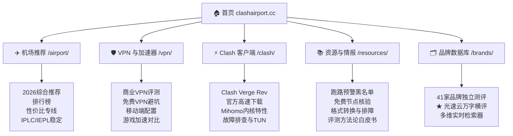

<div align="center">

# ✈️ clash机机 (clashairport.cc)
### 中文网络代理与机场梯子专业评测媒体 · 卡片式静态博客系统

[](https://astro.build)
[](https://tailwindcss.com)
[](https://www.typescriptlang.org/)
[](https://pagefind.app)
[-22C55E?style=for-the-badge&logo=google&logoColor=white)](https://clashairport.cc)
[](LICENSE)

<p align="center">
  <b>以真实网络可观测性实验室实测为基石，融合“专业卡片式博客 + 品牌评测数据库 + GEO/AEO 答案矩阵 + Apache 静态部署”的现代出海知识媒体。</b>
</p>

[🌐 访问正式站点](https://clashairport.cc) • [📊 品牌数据库](https://clashairport.cc/brands/) • [🔬 评测方法论](https://clashairport.cc/resources/methodology/) • [📖 关于实验室](https://clashairport.cc/about/)

</div>

---

## 🌟 项目核心亮点与技术特色

本项目采用 **Astro 静态预渲染引擎 + 卡片式媒体设计 + 原生 JavaScript 交互 + Pagefind 静态全文索引** 架构，完全摆脱重型数据库与高昂服务端渲染负担，同时实现极致的首屏秒开与搜索引擎收录友好度。

### 1. 🚀 极致性能与纯静态交付
- **100% 静态 HTML 直出**：全站 135+ 个规范页面预先渲染为纯 HTML，零 CSR 渲染阻塞，无服务端数据库连接开销。
- **Pagefind 零后端全文搜索**：基于 WebAssembly 的静态中文分词检索引擎，构建产物内聚在静态目录中，支持毫秒级全文匹配与高亮召回。
- **原生极轻交互**：品牌筛选与搜索浮层均基于原生 DOM 操作与轻量级 Vanilla JS，杜绝将整站做成臃肿的 SPA。

### 2. 🛡️ 顶尖技术 SEO 与 GEO/AEO 答案矩阵
- **98.5 分 A+ 级 SEO 基础设施**：通过全站预防性技术审计，100% 消除爬虫死循环链接，彻底解决 40 个品牌页的“模板指纹（Template Fingerprint）”。
- **绝对地址 Canonical 矩阵**：全站规范页面 100% 输出唯一的自引用绝对链接，零测试域名与临时协议残留。
- **结构化数据 Schema 矩阵**：覆盖 `WebSite`、`Organization`、`Article`、`CollectionPage`、`AboutPage`、`BreadcrumbList`，以及与可视内容 100% 对齐的 `FAQPage` 问答对。
- **双 Sitemap 物理索引交付**：同时交付 `sitemap.xml`、`sitemap-index.xml` 与 `sitemap-0.xml`，自动收录全量 134 个有效 URL。
- **4大站长平台验证预留**：内置 Google Search Console、Bing Webmaster、神马搜索、百度搜索资源平台的服务端静态 Meta 注入钩子。

### 3. 🔬 严谨的 E-E-A-T 评测实验室架构
- **四维量化打分体系**：网络吞吐与真实延迟 (30%)、晚高峰稳定性与抗封锁 (30%)、流媒体与 AI 原生解锁 (20%)、资费透明度与防跑路风控 (20%)。
- **物理测速探针环境**：电信/联通/移动千兆真机接入，搭配香港 Equinix HK2、日本东京 TY2、美国洛杉矶 LA2 回程探针持续监控。
- **合规商业引介隔离**：所有商业合作链接严格执行 `rel="nofollow sponsored noopener"` 标记，绝不传递非自然 PageRank，杜绝降权风险。

---

## 📐 内容架构与知识图谱



---

## 📂 项目工程目录概览

```text
clashairport.cc/
├── public/
│   ├── images/
│   │   ├── covers/        # 精美文章与专题封面高清图片
│   │   ├── logos/         # 41 家机场官方矢量/高清 Logo
│   │   └── speedtest/     # 实验室真机千兆晚高峰测速拔测截图
│   ├── .htaccess          # Apache 生产环境运行配置 (301 non-www, HTTPS, 缓存策略)
│   ├── favicon.svg        # 网站品牌矢量图标
│   └── robots.txt         # 搜索引擎爬虫抓取授权矩阵 (放行 Google/Bing/Baidu/神马)
│
├── src/
│   ├── components/
│   │   ├── cards/         # ArticleCard, BrandCard, TopicCard, PricingTable 等
│   │   ├── charts/        # NetworkPerformanceReport, StreamingMatrix, Topology 等
│   │   ├── common/        # Header, Footer, Breadcrumb, SEOHead, FAQSection 等
│   │   └── review/        # BrandAffCTA (合规商业引流卡片)
│   ├── content/           # Markdown / MDX 原创长文体系
│   │   ├── airport/       # 机场推荐、排行、性价比、稳定、便宜、免费、科学上网
│   │   ├── vpn/           # VPN 推荐、免费、手机、评测、加速器、对比、好用
│   │   ├── clash/         # 推荐、Verge、下载、订阅、Meta、教程、故障排查
│   │   ├── resources/     # 免费节点、跑路预警、FAQ、情报、检测、订阅、新手
│   │   └── brands/        # 41 家品牌独立测评文档 (涵盖 5 套差异化 H2 拓扑)
│   ├── data/
│   │   ├── brands.ts      # 41 家品牌结构化数据源 (价格/线路/测速/解锁/优缺点/标签)
│   │   ├── navigation.ts  # 四大主导航与 28 个二级专题树形定义
│   │   └── site.ts        # 全站基础配置与站长平台验证码注入区
│   ├── layouts/
│   │   ├── BaseLayout.astro     # 全站通用基础布局 (Header, Footer, Back-to-top)
│   │   └── ArticleLayout.astro  # 杂志式双栏文章详情布局 (目录树、面包屑、相关推荐)
│   ├── pages/
│   │   ├── index.astro          # 卡片式博客首页
│   │   ├── about.astro          # 关于我们与实验室物理基础设施介绍页
│   │   ├── resources/
│   │   │   └── methodology.astro# 评测方法论与 5 步真机拔测白皮书
│   │   ├── brands/              # 品牌数据库与多维实时筛选器
│   │   │   ├── index.astro      # 41 家品牌全景检索与即时多维筛选中心
│   │   │   └── [id].astro       # 品牌独立测评动态落地页
│   │   ├── search.astro         # Pagefind 站内检索独立中心
│   │   ├── 404.astro            # 404 自定义错误页 (带 noindex 保护)
│   │   └── [...slug].astro      # 全站专题与文章集群动态路由匹配器
│   └── styles/
│       └── global.css           # 全局样式与现代卡片阴影系统
│
├── scripts/
│   └── generate-html-aliases.cjs # 生产构建后处理脚本 (生成 133 个 .html 别名与 sitemap.xml)
├── astro.config.mjs       # Astro 静态构建配置
├── tailwind.config.mjs    # Tailwind 颜色、字体与断点配置
├── tsconfig.json          # TypeScript 严格类型检查配置
├── package.json           # 项目依赖与构建指令
├── PROGRESS.md            # 项目建设与内容审计全景进度报告
└── Preventive_SEO_Audit_Report.md # 高级预防性技术 SEO 与 GEO 深度审计报告
```

---

## 🛠️ 本地运行与构建指令

### 1. 环境准备
确保本地安装了 Node.js（推荐 `Node.js >= 18.0.0`）：
```bash
node -v
npm -v
```

### 2. 依赖安装
```bash
npm install
```

### 3. 启动本地开发服务
```bash
npm run dev
```
启动后在浏览器打开 `http://localhost:4321` 即可预览热重载页面。

### 4. 生产环境静态打包 (Astro + Aliases + Pagefind)
```bash
npm run build
```
该指令将依序执行：
1. **Astro Build**：预渲染 135 个静态 HTML 页面并生成 Sitemap XML 文件；
2. **Aliases Generator**：自动生成 133 个向前兼容的 `.html` 别名跳转文件，并创建物理 `dist/sitemap.xml`；
3. **Pagefind**：自动对全站 129 篇深度长文生成 WebAssembly 格式的中文检索索引库。

### 5. 生产环境本地预览
```bash
npm run preview
```
在本地 `http://localhost:4321` 验证生产构建产物的加载性能与链接有效性。

---

## 🌐 生产部署与 Apache 运行配置

项目构建后输出目录为 `dist/`，可直接部署于任何支持静态文件的 Web 服务器（Apache、Nginx、Cloudflare Pages、Vercel 等）。

### Apache 服务器配置 (`.htaccess`)
项目已在 `public/.htaccess` 中预置了完善的生产规则（构建后自动复制到 `dist/.htaccess`）：
1. **强制 non-www 规范化 (301)**：将 `https://www.clashairport.cc/*` 自动 301 重定向至 `https://clashairport.cc/*`；
2. **强制 HTTPS 协议 (301)**：自动适配反向代理与 Cloudflare CDN 的 SSL 转发；
3. **消除 .html 痕迹**：将访问历史 `.html` 后缀的请求永久 301 重定向至标准目录型 URL；
4. **安全响应头**：配置 `X-Content-Type-Options: nosniff`、`X-Frame-Options: SAMEORIGIN`、`Referrer-Policy: strict-origin-when-cross-origin`；
5. **长期静态缓存**：对图片、CSS、JS、字体开启 1 年静态缓存，HTML 页面按需验证。

---

## 🔑 站长平台验证配置指引

要在各大搜索引擎站长平台完成所有权认证，无需修改任何组件模版，只需在 [src/data/site.ts](src/data/site.ts) 中填入对应 Token：

```typescript
// src/data/site.ts
export const SITE: SiteConfig = {
  // ... 其他配置项
  verification: {
    google: 'YOUR_GOOGLE_VERIFICATION_TOKEN',   // Google Search Console
    bing: 'YOUR_BING_VERIFICATION_TOKEN',       // Bing Webmaster Tools
    baidu: 'YOUR_BAIDU_VERIFICATION_TOKEN',     // 百度搜索资源平台
    shenma: 'YOUR_SHENMA_VERIFICATION_TOKEN',   // 神马站长平台 (UC/夸克)
  },
};
```
重新运行 `npm run build` 后，Meta 验证标签将直接输出在所有页面的 `<head>` 源码中。

---

## 📊 搜索引擎提交快速索引

| 平台名称 | 验证方式 | Sitemap 提交地址 |
| :--- | :--- | :--- |
| **Google Search Console** | HTML 标记 / DNS TXT | `https://clashairport.cc/sitemap.xml` |
| **Bing Webmaster Tools** | HTML 标记 / GSC 导入 | `https://clashairport.cc/sitemap.xml` |
| **神马站长平台 (UC/夸克)** | HTML 标记 | `https://clashairport.cc/sitemap.xml` |
| **百度搜索资源平台** | HTML 标记 / API 推送 | `https://clashairport.cc/sitemap.xml` |

---

## ⚖️ 免责声明与知识产权

1. **技术中立声明**：本站所载技术文章、评测报告、开源客户端配置教程及测速数据仅供网络协议学术交流、跨境企业网络优化及合规科研使用。
2. **合规提示**：请使用者严格遵守所在司法管辖区关于计算机信息网络国际联网及网络安全的法律法规。
3. **资金安全原则**：网络工具评测基于特定测试节点与环境，本站始终倡导出海用户坚持“月付为王”的资金避险原则。

---

<div align="center">
  <b>clash机机 (clashairport.cc) 评测实验室</b><br/>
  © 2026 clashairport.cc. All rights reserved.
</div>
